 

  

 

### Also built

- **Aetheron AI** — self-hosted, privacy-first AI search. RAG over SearXNG + Jina Reader, streamed via SSE, zero paid search APIs. `Next.js` `Groq · Llama 4`
- **Dine-In Recommendation Engine** — classical-ML system design with no LLM: collaborative filtering, TF-IDF, Bayesian popularity, FP-Growth, MMR, queuing theory.

 

© 2026 John Smilin D.S. · Open to collaborations and interesting ideas · [LinkedIn](https://linkedin.com/in/johnsmilin) · [GitHub](https://github.com/smilin01) · [Instagram](https://instagram.com/the.smilin)

