


 

  



<a href="https://resumenova.in"></a>







<a href="https://johnsmilin.in"></a>

 

© 2026 John Smilin D.S. · [johnsmilin.in](https://johnsmilin.in) · [LinkedIn](https://linkedin.com/in/johnsmilin) · [GitHub](https://github.com/smilin01) · [Instagram](https://instagram.com/the.smilin)

