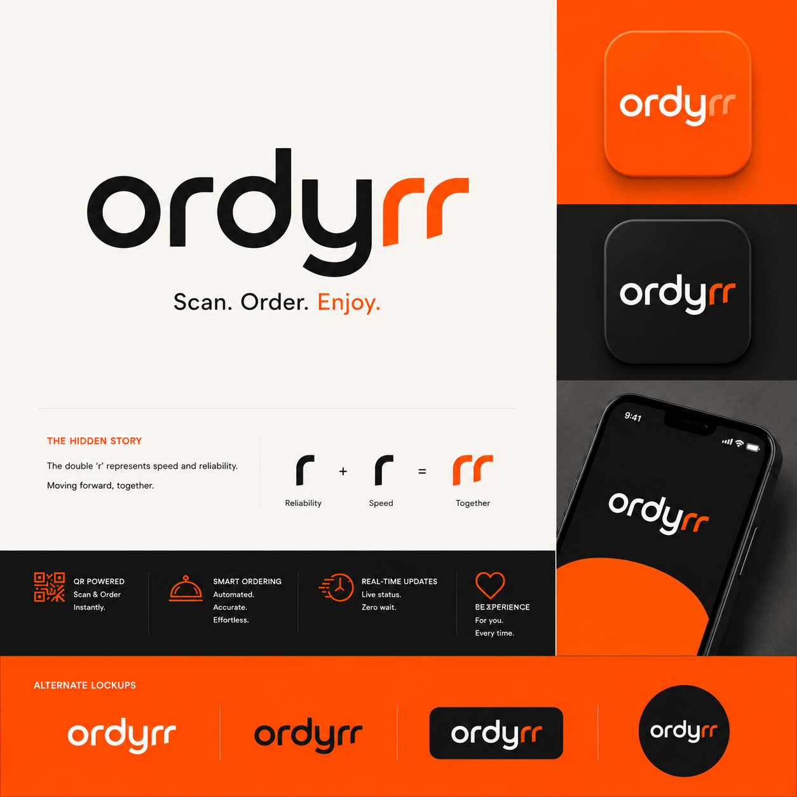
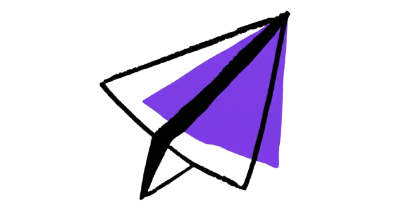

 

 

> **I build agents, not demos.** AI Engineer at Atos — I own the Atos coding agent end-to-end, and I run two live products on the side: Ordyrr and ResumeNova.

 

## `01` &nbsp;Flagship at Atos — Coding Agent

I designed, built and own this project from the first line to rollout. A coding agent that plans a task, calls tools, edits code, and verifies its own work before handing it back.

| | |
|:--|:--|
| **Ownership** | Sole builder — architecture, agent loop, tooling, skills, delivery |
| **Core pieces** | Agent loop · tool-use layer · reusable skills · context management · guardrails |
| **Principle** | Production-first: observable, testable, safe by default |

 

## `02` &nbsp;Products

<table>
<tr>
<td width="50%" valign="top">

### Ordyrr
**Scan. Order. Enjoy.**

Agentic QR-based dine-in & takeaway ordering. Guests scan, order and track status live; owners get a full operations dashboard.

`Django` `React` `PostgreSQL` `JWT`

Microservices: `auth` · `menu` · `order` · `notification` — with role-based access control.

</td>
<td width="50%" valign="top">

### ResumeNova
**[resumenova.in](https://resumenova.in)**

Agentic AI resume builder. An agent layer keeps the LaTeX and visual editors in sync through one normalized JSON state, with a credit-based usage system.

`Next.js` `LLM Agents` `LaTeX`

Roadmap: live ATS scoring · Quantification Coach · LinkedIn import.

</td>
</tr>
</table>

 

## `03` &nbsp;Other work

<table>
<tr>
<td width="50%" valign="top">

### Aetheron AI
Self-hosted, privacy-first AI search. RAG over self-hosted SearXNG + Jina Reader, streamed via SSE — zero paid search APIs.

`Next.js 14` `Groq · Llama 4` `RAG`

</td>
<td width="50%" valign="top">

### Dine-In Recommendation Engine
Classical-ML system design with zero LLM dependency — collaborative filtering, TF-IDF / cosine, Bayesian popularity, FP-Growth, MMR diversity, queuing theory for wait times.

`Recommender systems` `System design`

</td>
</tr>
</table>

 

## `04` &nbsp;Skills

| Agentic AI | LLM engineering | Platform |
|:--|:--|:--|
| Coding agents (plan → act → verify) | RAG pipelines | Microservices — Django, Node |
| Multi-agent orchestration | Prompt & context engineering | Docker · Kubernetes · AWS |
| Tool use & function calling | Streaming UX (SSE) | CI/CD · Git workflows |
| Agent skills design | LLM-driven automation | PostgreSQL · JWT / RBAC |
| MCP integrations | Evaluation & guardrails | Linux |

&nbsp;
&nbsp;
&nbsp;
&nbsp;
&nbsp;
&nbsp;
&nbsp;
&nbsp;
&nbsp;
&nbsp;
&nbsp;

 

## `05` &nbsp;Activity

 

**Let's connect** — [LinkedIn](https://linkedin.com/in/johnsmilin) · [GitHub](https://github.com/smilin01) · [Instagram](https://instagram.com/the.smilin) · [ResumeNova.in](https://resumenova.in)

